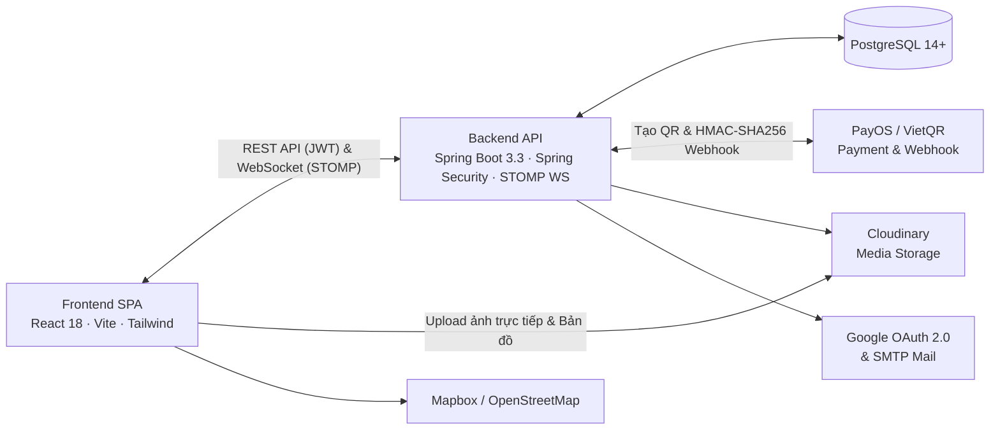

<div align="center">

# 🧺 LaundryHub — Nền Tảng Kết Nối & Quản Lý Giặt Sấy Thông Minh

**Hệ thống sàn thương mại dịch vụ giặt là đa vai trò (Khách hàng · Chủ tiệm · Quản trị viên) tích hợp bản đồ định vị, thanh toán VietQR/PayOS, đối soát tự động và tương tác Real-time.**

[](https://adoptium.net/)
[](https://spring.io/projects/spring-boot)
[](https://react.dev/)
[](https://vitejs.dev/)
[](https://tailwindcss.com/)
[](https://www.postgresql.org/)
[](https://www.docker.com/)

</div>

---

## Mục Lục

- [1. Tổng Quan Dự Án](#1-tổng-quan-dự-án)
- [2. Tính Năng Chính](#2-tính-năng-chính)
- [3. Kiến Trúc Hệ Thống](#3-kiến-trúc-hệ-thống)
- [4. Công Nghệ Sử Dụng](#4-công-nghệ-sử-dụng)
- [5. Cấu Trúc Thư Mục](#5-cấu-trúc-thư-mục)
- [6. Hướng Dẫn Cài Đặt & Chạy Local](#6-hướng-dẫn-cài-đặt--chạy-local)
- [7. Biến Môi Trường](#7-biến-môi-trường)
- [8. Kiểm Thử, Build & Triển Khai](#8-kiểm-thử-build--triển-khai)
- [9. Bảo Mật](#9-bảo-mật)
- [10. Xử Lý Sự Cố Thường Gặp](#10-xử-lý-sự-cố-thường-gặp)

---

## 1. Tổng Quan Dự Án

**LaundryHub** là nền tảng full-stack kết nối khách hàng có nhu cầu giặt sấy với các tiệm giặt uy tín xung quanh. Hệ thống hỗ trợ trọn vẹn vòng đời đơn hàng từ tìm kiếm theo bán kính địa lý, đặt lịch giao nhận hai chiều, cân đo thực tế tại tiệm, thanh toán tự động qua **PayOS / VietQR**, quản lý bán hàng tại quầy (**POS**), xử lý khiếu nại (**Dispute**), đối soát giải ngân định kỳ (**Payout**) đến trò chuyện & thông báo tức thời (**WebSocket STOMP**).

---

## 2. Tính Năng Chính

### 👤 Dành cho Khách hàng (`CUSTOMER`)
- **Xác thực & Tài khoản**: Đăng ký/đăng nhập bằng SĐT hoặc Email, đăng nhập nhanh với **Google OAuth 2.0**, quên/đặt lại mật khẩu qua email, quản lý ảnh đại diện và **Sổ địa chỉ** gắn tọa độ bản đồ.
- **Khám phá Tiệm giặt**: Tìm tiệm theo vị trí hiện tại & bán kính, xem chế độ danh sách hoặc bản đồ tương tác, lọc theo danh mục dịch vụ, đánh giá sao, khoảng cách và giá.
- **Đặt đơn linh hoạt**: Hỗ trợ giao/nhận 2 chiều (tự mang tới / tiệm đến lấy, tự đến lấy / tiệm giao tận nơi), tự động tính phí ship theo khoảng cách Haversine, áp dụng mã giảm giá (**Voucher**).
- **Theo dõi & Thanh toán**: Thanh toán tiền mặt (`COD`) hoặc quét mã **VietQR / PayOS** tự động xác nhận qua webhook; cập nhật tiến độ đơn hàng real-time; chat trực tiếp với chủ tiệm; đánh giá dịch vụ kèm hình ảnh; mở khiếu nại bồi thường khi có sự cố.

### 🏪 Dành cho Chủ tiệm (`SHOP_OWNER`)
- **Thiết lập & Quản lý Tiệm**: Đăng ký hồ sơ tiệm (chờ Admin phê duyệt), cấu hình vị trí, giờ mở cửa, số máy giặt/sấy, biểu phí giao nhận và ảnh thư viện.
- **Quản lý Danh mục & Dịch vụ**: Tạo/sửa/ẩn dịch vụ (giá cố định `FIXED` hoặc báo giá sau `CONTACT`, hỗ trợ `minCharge`), tùy biến danh mục và đơn vị tính (`Kg`, `Cái`, `Bộ`, `Đôi`, ...), phát hành Voucher khuyến mãi.
- **Vận hành Đơn hàng & POS**: Quản lý đơn theo State Machine chặt chẽ (`PENDING → CONFIRMED → PICKING_UP → RECEIVED → PROCESSING → READY → DELIVERING → COMPLETED`), cân đo thực tế & chốt giá, tạo đơn nhanh tại quầy (**POS**).
- **Tài chính, Khiếu nại & Thống kê**: Phản hồi khiếu nại (chuyển khoản VietQR hoặc cấp mã voucher bồi hoàn), theo dõi doanh thu đối soát & lịch sử giải ngân từ Sàn, xem biểu đồ thống kê doanh thu/dịch vụ/kênh bán hàng.

### 🛡️ Dành cho Quản trị viên (`ADMIN`)
- **Quản trị Hệ thống**: Phê duyệt / từ chối hồ sơ mở tiệm, khóa/mở khóa tài khoản người dùng và trạng thái hoạt động của tiệm, xem KPI tổng quan toàn sàn.
- **Phân xử Tranh chấp**: Tiếp nhận khiếu nại leo thang từ khách hàng, đối chiếu bằng chứng hai bên và ra phán quyết bồi hoàn.
- **Đối soát & Giải ngân (Payout)**: Tự động chốt kỳ hàng tuần (`@Scheduled`) hoặc tạo đợt thủ công, tính hoa hồng sàn, quét VietQR giải ngân cho chủ tiệm và đính kèm chứng từ.
- **Hỗ trợ CSKH Real-time**: Tiếp nhận và phản hồi hội thoại hỗ trợ trực tiếp với Khách hàng và Chủ tiệm.

---

## 3. Kiến Trúc Hệ Thống



---

## 4. Công Nghệ Sử Dụng

| Tầng | Công nghệ |
| :--- | :--- |
| **Backend** | Java 17, Spring Boot 3.3.4, Spring Web, Spring Data JPA, Spring Security, Spring WebSocket (STOMP/SockJS), Spring Validation, Spring Mail, JJWT `0.11.5`, Lombok |
| **Database** | PostgreSQL 14+ |
| **Frontend** | React 18, Vite 5, Tailwind CSS 3.4, Axios, `@stomp/stompjs` & `sockjs-client`, Recharts, Mapbox GL / Leaflet, `react-hot-toast`, `date-fns`, `qrcode.react` |
| **Tích hợp & Hạ tầng** | PayOS API (VietQR), Google Identity Services (OAuth 2.0), Cloudinary, Docker (multi-stage build), Vercel (Frontend), Render (Backend) |

---

## 5. Cấu Trúc Thư Mục

```text
laundry-hub/
├── backend/                          # Spring Boot 3 REST & WebSocket API
│   ├── src/main/java/com/laundry/
│   │   ├── auth/                     # Đăng nhập, đăng ký, JWT & Refresh Token
│   │   ├── common/                   # GlobalExceptionHandler, HealthCheck
│   │   ├── config/                   # WebSocketConfig, DataSeeder
│   │   ├── controller/               # REST Controllers (Customer, Owner, Admin, Payment, Chat, Support)
│   │   ├── dto/                      # Request & Response DTOs
│   │   ├── entity/ & enums/          # JPA Entities & Domain Enums
│   │   ├── repository/               # Spring Data JPA Repositories
│   │   ├── security/                 # SecurityConfig, JWT Filter, Rate Limiting, WS Auth Interceptor
│   │   ├── service/                  # Business Logic & OrderStateMachineService
│   │   └── util/                     # GeoUtils (Haversine distance)
│   ├── src/main/resources/
│   │   └── application.example.yml   # Mẫu cấu hình Backend
│   ├── Dockerfile                    # Multi-stage Docker build (non-root runtime)
│   └── pom.xml
├── frontend/                         # React + Vite SPA
│   ├── src/
│   │   ├── api/                      # Axios client + Auto Refresh Token interceptor
│   │   ├── components/               # Modals, Tabs, Chat, Maps, NotificationBell
│   │   ├── context/                  # AuthContext, WebSocketContext
│   │   ├── hooks/                    # Custom hooks (Geolocation)
│   │   ├── pages/                    # Discovery, MyOrders, OwnerDashboard, AdminDashboard, ResetPassword
│   │   └── utils/                    # Geo & Order status helpers
│   ├── .env.example                  # Mẫu biến môi trường Frontend
│   ├── .eslintrc.cjs                 # Cấu hình ESLint
│   ├── vercel.json                   # Cấu hình deploy & Security Headers (CSP/HSTS)
│   └── vite.config.js
└── README.md
```

---

## 6. Hướng Dẫn Cài Đặt & Chạy Local

### Yêu cầu hệ thống (Prerequisites)
- **Java 17+**
- **Maven 3.9+**
- **Node.js 18+** & **npm**
- **PostgreSQL 14+**

### Bước 1: Tạo Database PostgreSQL
Khởi động PostgreSQL và tạo database `laundry_db`:
```sql
CREATE DATABASE laundry_db;
```

### Bước 2: Cấu hình & Chạy Backend
```bash
cd backend

# Tạo file cấu hình local từ file mẫu và điền thông tin DB, JWT secret, PayOS, Cloudinary...
cp src/main/resources/application.example.yml src/main/resources/application.yml

# Build & chạy unit tests
mvn clean test

# Khởi chạy Spring Boot server
mvn spring-boot:run
```
- API chạy tại: `http://localhost:8080`
- Health Check: `http://localhost:8080/api/v1/health`

### Bước 3: Cấu hình & Chạy Frontend
Mở một terminal mới tại thư mục gốc:
```bash
cd frontend

# Tạo file biến môi trường từ file mẫu
cp .env.example .env

# Cài đặt dependencies
npm install

# Khởi chạy Vite dev server
npm run dev
```
- Ứng dụng chạy tại: `http://localhost:5173` (tự động proxy `/api` và `/ws` sang `http://localhost:8080`).

---

## 7. Biến Môi Trường

> **Lưu ý bảo mật:** Tuyệt đối không commit file `.env` hoặc `backend/src/main/resources/application.yml` chứa khóa thật lên Git (đã được chặn trong `.gitignore`).

### Backend (`application.yml` / Environment Variables)
| Biến môi trường | Bắt buộc | Mô tả |
| :--- | :---: | :--- |
| `SPRING_DATASOURCE_URL` | ✅ | JDBC URL của PostgreSQL (mặc định `jdbc:postgresql://localhost:5432/laundry_db`) |
| `SPRING_DATASOURCE_USERNAME` / `PASSWORD` | ✅ | Tài khoản kết nối PostgreSQL |
| `APP_JWTSECRET` | ✅ | Khóa bí mật ký JWT (chuỗi Base64 ≥ 32 bytes) |
| `APP_CORS_ALLOWED_ORIGINS` | ✅ | Danh sách origin được phép gọi API (phân cách bằng dấu phẩy, không dùng wildcard) |
| `APP_FRONTEND_URL` | ✅ | URL frontend (dùng cho link đặt lại mật khẩu & PayOS `returnUrl`/`cancelUrl`) |
| `GOOGLE_CLIENT_ID` | ⬜ | Google OAuth 2.0 Client ID (khớp với `VITE_GOOGLE_CLIENT_ID`) |
| `PAYOS_CLIENT_ID` / `API_KEY` / `CHECKSUM_KEY` | ⬜ | Thông tin tích hợp thanh toán PayOS & xác thực chữ ký webhook |
| `CLOUDINARY_CLOUD_NAME` / `API_KEY` / `API_SECRET` | ⬜ | Lưu trữ và dọn dẹp ảnh trên Cloudinary |
| `SPRING_MAIL_USERNAME` / `PASSWORD` | ⬜ | Tài khoản SMTP gửi email đặt lại mật khẩu |

### Frontend (`frontend/.env`)
| Biến môi trường | Mô tả |
| :--- | :--- |
| `VITE_API_BASE_URL` | URL Backend API (để trống khi chạy local để dùng proxy `/api/v1`) |
| `VITE_WS_URL` | URL WebSocket (tùy chọn, mặc định suy ra từ `VITE_API_BASE_URL` hoặc `/ws`) |
| `VITE_GOOGLE_CLIENT_ID` | Google OAuth 2.0 Client ID |
| `VITE_CLOUDINARY_CLOUD_NAME` / `VITE_CLOUDINARY_UPLOAD_PRESET` | Cấu hình upload ảnh trực tiếp lên Cloudinary |
| `VITE_MAPBOX_TOKEN` | Token Mapbox cho bản đồ chọn vị trí & tìm kiếm địa chỉ |

---

## 8. Kiểm Thử, Build & Triển Khai

### Chạy kiểm tra chất lượng mã nguồn
```bash
# Backend: chạy unit tests
cd backend && mvn test

# Frontend: kiểm tra ESLint & production build
cd frontend && npm run lint && npm run build
```

### Build & chạy Backend bằng Docker
```bash
cd backend
docker build -t laundry-hub-backend .
docker run -p 8080:8080 --env-file .env laundry-hub-backend
```

---

## 9. Bảo Mật

- **Authentication & Session**: JWT stateless kết hợp **Refresh Token Rotation**, tự động làm mới token trên `401` và thu hồi toàn bộ phiên khi đăng xuất hoặc đổi mật khẩu.
- **Authorization & Anti-IDOR**: Phân quyền chặt theo vai trò (`CUSTOMER`, `SHOP_OWNER`, `ADMIN`), kiểm tra quyền sở hữu tài nguyên trên từng API (Order, Payout, Voucher, Service, Address) và whitelist kênh subscribe trong `WebSocketAuthInterceptor`.
- **Payment Integrity**: Xác thực chữ ký **HMAC-SHA256** (constant-time comparison) cho PayOS webhook, kiểm tra idempotency và đối chiếu khớp số tiền thanh toán.
- **Web Hardening**: Strict CORS allowlist (không wildcard), Security Headers (`CSP`, `HSTS`, `X-Frame-Options: DENY`, `X-Content-Type-Options: nosniff`, `Referrer-Policy`), Rate Limiting cho các endpoint xác thực và ẩn source maps trên production.

---

## 10. Xử Lý Sự Cố Thường Gặp

| Sự cố | Nguyên nhân & Cách khắc phục |
| :--- | :--- |
| **Backend không khởi động được (lỗi `APP_JWTSECRET`)** | Chưa thiết lập `app.jwtSecret` trong `application.yml` hoặc biến môi trường `APP_JWTSECRET`. Hãy cung cấp chuỗi Base64 dài tối thiểu 32 bytes. |
| **Lỗi kết nối PostgreSQL (`Connection Refused` / `FATAL`)** | Kiểm tra dịch vụ PostgreSQL đã chạy chưa, database `laundry_db` đã tồn tại và username/password trong `application.yml` đã chính xác chưa. |
| **Cổng `8080` đã được sử dụng** | Đổi `server.port` trong `application.yml` và cập nhật lại `target` proxy trong `frontend/vite.config.js`. |
| **Nút đăng nhập Google không hiển thị hoặc báo lỗi** | Kiểm tra đã điền đúng cùng một `Client ID` cho cả `GOOGLE_CLIENT_ID` (Backend) và `VITE_GOOGLE_CLIENT_ID` (Frontend), và đã thêm origin (`http://localhost:5173`) vào Authorized JavaScript Origins trên Google Cloud Console. |
| **Không chọn được vị trí trên bản đồ** | Đảm bảo đã cấu hình `VITE_MAPBOX_TOKEN` hợp lệ trong `frontend/.env`. |
